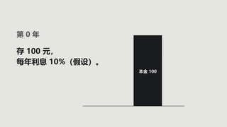
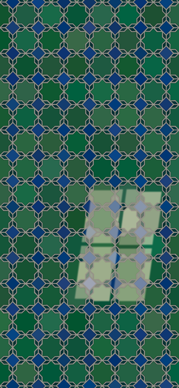
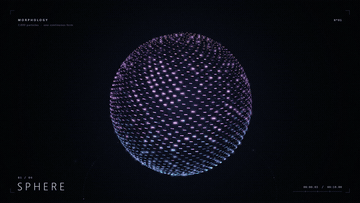
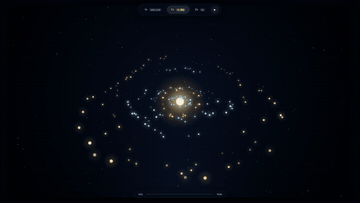

# 青出 · Indigo

> **English summary.** *Indigo* (from the proverb "indigo comes from the indigo plant, yet is bluer than it") is a framework for absorbing other people's AI design and video skills **without inheriting their style**, plus a quality standard to judge the results. Instead of installing someone's skill, it runs isolated steps — **learn** (extract principles), **forget** (strip names, numbers and recipes), **rewrite** (an agent that never saw the sources re-derives everything from first principles), **check** (an independent agent verifies the rewrite doesn't reproduce the sources). On the creative side it enforces *diverge first, then converge*, a ban list of "AI-default looks", and blind review. In blind tests, outputs made with the framework ranked first in all 6 rankings of round 1 (5 groups, 3 models), and won 5 of 6 rankings in round 2 (Opus 5.5 only, with vs. without, 3 runs each). Docs are in Chinese.

青出取"青出于蓝而胜于蓝"：向别人学，最后超过它。

**一句话**：让 AI 做设计、动效、视频时，既不照搬别人的 skill，也不落进模型自己的默认审美。

| | 用了青出 | 不用框架 |
|---|---|---|
| 第 1 轮（3 个模型 × 3 题，2 位盲评） | 6 份排名的第 1 名全部是 | 不同模型撞出三对几乎一样的作品 |
| 第 2 轮（Opus 5.5，各 3 次 × 3 题，2 位盲评） | 5/6 份排名领先，唯一的 L3 | 落在"奶油底 + 橙红日轮"这类默认模板 |

目录：[为什么要有它](#为什么要有它) · [它是怎么工作的](#它是怎么工作的) · [怎么用](#怎么用) · [测试结果](#测试结果) · [目录结构](#目录结构) · [当前状态](#当前状态v01) · [来源与许可](#来源与许可)

## 为什么要有它

装一个别人的 skill，做出来的东西就会像那个 skill；大家装同一批 skill，作品就越来越像。模型本身也有默认审美，不加约束时，不同模型会撞出几乎一样的作品。

青出做两件事：

1. **吸收而不照搬**：别人的 skill、教程、提示词，只取"意"（要解决什么问题、为什么有效、边界在哪），丢掉"形"（参数、配方、风格名、固定版式），再由一个从没见过原料的 agent 从原理重新推导，最后由独立 agent 检验没有复现原料。
2. **标准固定，风格开放**：创作时先放开（想出几个彼此差得远的方向，避开 AI 默认外观），再收拢（说清理由选一个）；做完按质量标准评审，不达标就回炉。

## 它是怎么工作的

**吸收**：任何新来源（skill、教程、提示词、作品、工具）进来，都走同一条线，每一步由独立的 agent 完成，读权限严格隔离：

```
整理 → 学（拆成原理卡） → 忘（剥掉名字、数值、配方，只留问题和原理）
     → 重写（没见过原料的 agent 从第一性原理推导） → 检验（对照原料，复现过多就退回）
     → 防偏移检查（框架本身不能被新来源带歪）
```

**创作**：

```
理解需求（已说 / 隐含 / 空白） → 写出默认答案并排除 → 发散几个彼此差得远的方向
     → 说清理由收拢到一个 → 写简报（3–6 条"做到什么算完"） → 制作 → 自检 → 独立评审 → 回炉（最多 2 轮）
```

框架里什么能变、什么不能变，写在宪章 [`framework/charter.md`](framework/charter.md)：吸收进来的东西只能让内容变多，不能改变框架本身。

## 怎么用

**任何模型（最简单）**：把 [`core/indigo-core-v1.md`](core/indigo-core-v1.md) 作为系统提示，再提你的需求。模型会先写出理解、排除的默认方向、几个候选方向和选择理由，再交付作品。

**Claude Code 等支持 skill 的工具**：把整个仓库放进 skills 目录（例如 `~/.claude/skills/indigo/`），说"用青出做……"或"用青出评审这条片子"。入口见 [`SKILL.md`](SKILL.md)。

**吸收新的 skill / 教程 / 提示词**：按 [`framework/charter.md`](framework/charter.md)（宪章，不可被吸收内容改变）和 [`framework/protocol.md`](framework/protocol.md) 走 学 → 忘 → 重写 → 检验 → 防偏移检查。四个步骤各有一份给 agent 的指令：`framework/*-brief.md`。

## 测试结果

评分：L0 坏 / L1 能用 / L2 商业合格 / L3 精品 / L4 惊艳。评审都是盲评，不知道作品出自哪一组。

### 第 2 轮（2026-11-19）：只用 Opus 5.5，用 vs 不用，各 3 次

同一个模型，用青出（A 组）和不用（B 组）各独立做 3 次，三道新题：「帮我做一张音乐节海报」「做一个 20 秒的动画，给普通人讲清楚什么是复利」「给一个叫"山野咖啡"的品牌做一个 8 秒的 Logo 开场动画」。18 件作品随机编号，两位独立的 Opus 评审盲评。

| 题目 | 评审 a 排序 | 评审 b 排序 |
|---|---|---|
| 海报 | B1 > B3 > A2 > B2 > A3 > A1 | B3 > A2 > A3 > B1 > A1 > B2 |
| 复利动画 | **A3** > A2 > B2 > A1 > B3 > B1 | **A3** > A2 > B2 > B3 > B1 > A1 |
| Logo 开场 | **A1** > A3 > B2 > A2 > B1 > B3 | **A1** > A3 > A2 > B2 > B3 > B1 |

- 6 份排名里 5 份青出组平均名次更好；两位评审"每题只选一件"的 6 次选择里 5 次选了青出组；全轮唯一的 L3（两位评审一致）来自青出组。
- 两组各自撞车：无框架组落在"奶油底 + 橙红日轮 / 米色讲解模板 / 暗底发光山线"这类默认模板上；青出组落在"等高线 / 俯视人群双色套印 / 三色分层柱"这类从题材出发的想法上，记忆点更强，但三次之间也重复了。
- 海报题青出组输了：三张都给缺失的节名和日期留了空白填写栏，被判"占位"。

结论：框架有效，没有限制创意；同时暴露出两个要修的问题（"不编造"规则把样稿内容留空、框架自己的"第二层默认"）。详见 [`eval/round2-results.md`](eval/round2-results.md)。

#### 第 2 轮作品

**海报**

| 青出 A1 | 青出 A2 | 青出 A3 | 无框架 B1 | 无框架 B2 | 无框架 B3 |
|---|---|---|---|---|---|
|  |  |  |  |  |  |

**复利科普动画**

| 青出 A1 | 青出 A2 | 青出 A3 | 无框架 B1 | 无框架 B2 | 无框架 B3 |
|---|---|---|---|---|---|
| <br>[视频](eval/preview-r2/T2_A1.mp4) | <br>[视频](eval/preview-r2/T2_A2.mp4) | <br>[视频](eval/preview-r2/T2_A3.mp4) | <br>[视频](eval/preview-r2/T2_B1.mp4) | <br>[视频](eval/preview-r2/T2_B2.mp4) | <br>[视频](eval/preview-r2/T2_B3.mp4) |

**山野咖啡 Logo 开场**

| 青出 A1 | 青出 A2 | 青出 A3 | 无框架 B1 | 无框架 B2 | 无框架 B3 |
|---|---|---|---|---|---|
| <br>[视频](eval/preview-r2/T3_A1.mp4) | <br>[视频](eval/preview-r2/T3_A2.mp4) | <br>[视频](eval/preview-r2/T3_A3.mp4) | <br>[视频](eval/preview-r2/T3_B1.mp4) | <br>[视频](eval/preview-r2/T3_B2.mp4) | <br>[视频](eval/preview-r2/T3_B3.mp4) |

### 第 1 轮（2026-11-18）：三个模型，用 vs 不用

三句普通需求：「帮我做一张手机壁纸」「做一个高质量的网页动画」「给一款记账 App 做一个 15 秒的宣传动效」。五组各做一次，两位独立评审盲评（不知道作品出自哪一组）。L0 坏 / L1 能用 / L2 商业合格 / L3 精品 / L4 惊艳。

| 组 | 壁纸 | 网页动画 | 记账 App 宣传 |
|---|---|---|---|
| Fable + 青出 | **L2 / L2** | **L3 / L3** | **L2 / L2** |
| Opus 5.5 + 青出 | **L2 / L2** | L1 / L1 | L3 / L0（评审分歧） |
| Fable 无框架 | L1 / L1 | L0 / L1 | L1 / L1 |
| Opus 5.5 无框架 | L0 / L1 | L0 / L1 | L1 / L1 |
| DeepSeek v4-pro 无框架 | L0 / L0 | L0 / L0 | L0 / L0 |

- 6 份排名（2 位评审 × 3 题）的第 1 名全部是用了青出的作品。
- 不用框架时，两个模型撞出了三对几乎一样的作品（紫色晚霞山景、粒子变形、"左字右手机"的宣传片，后者连口号都相同）；用了青出的作品没有撞车。
- 青出也暴露了问题：两个模型都想到了"小票"这个创意（第二层同质化）；动效节奏起伏不足；有细节失误。
- 局限：每组每题只跑一次；两位评审都是 Claude 家族模型；DeepSeek + 青出这一组因为接口不稳定还没跑成。

作品、过程文件和评审原文都在 [`eval/`](eval/)，结论见 [`eval/round1-results.md`](eval/round1-results.md)。

#### 第 1 轮作品

每格下面是两位评审给的级别（Fable 评审 / Opus 评审）。动图是缩小的预览，点"完整视频"看原片。

**T1「帮我做一张手机壁纸」**

| Fable + 青出 | Opus 5.5 + 青出 | Fable 无框架 | Opus 5.5 无框架 | DeepSeek 无框架 |
|---|---|---|---|---|
|  |  |  |  |  |
| L2 / L2 | L2 / L2 | L1 / L1 | L0 / L1 | L0 / L0 |

**T2「做一个高质量的网页动画」**

| 组 | 预览 | 级别 |
|---|---|---|
| Fable + 青出 | <br>[完整视频](eval/preview/T2_fable-indigo.mp4) | L3 / L3 |
| Opus 5.5 + 青出 | <br>[完整视频](eval/preview/T2_opus-indigo.mp4) | L1 / L1 |
| Fable 无框架 | <br>[完整视频](eval/preview/T2_fable-raw.mp4) | L0 / L1 |
| Opus 5.5 无框架 | <br>[完整视频](eval/preview/T2_opus-raw.mp4) | L0 / L1 |
| DeepSeek 无框架 | <br>[完整视频](eval/preview/T2_deepseek-raw.mp4) | L0 / L0 |

**T3「给一款记账 App 做一个 15 秒的宣传动效」**

| 组 | 预览 | 级别 |
|---|---|---|
| Fable + 青出 | <br>[完整视频](eval/preview/T3_fable-indigo.mp4) | L2 / L2 |
| Opus 5.5 + 青出 | <br>[完整视频](eval/preview/T3_opus-indigo.mp4) | L3 / L0（印章被遮挡，评审分歧） |
| Fable 无框架 | <br>[完整视频](eval/preview/T3_fable-raw.mp4) | L1 / L1 |
| Opus 5.5 无框架 | <br>[完整视频](eval/preview/T3_opus-raw.mp4) | L1 / L1 |
| DeepSeek 无框架 | <br>[完整视频](eval/preview/T3_deepseek-raw.mp4) | L0 / L0 |

## 目录结构

| 路径 | 内容 |
|---|---|
| `core/` | 精简版系统提示（约 1.7 万字），给任何模型直接用 |
| `books/` | 六本书：动效节奏、视觉设计、镜头与叙事、声音、需求理解、风格词汇库 |
| `standards/` | 质量标准（目前只有动效）和底线检查脚本 |
| `framework/` | 宪章、执行规范、各步骤指令、变更记录、发布规则 |
| `eval/` | 测试题、评分表、各组作品与过程、两份盲评原文、渲染与调用脚本 |

## 当前状态：v0.1

- 六本书都通过了"不复现原料"的检验，但检验同时发现骨架里漏进了部分来源的成套结构，书的一些章节离来源仍然偏近，正在按重写清单修订。
- 质量标准目前只覆盖动效；视觉设计、镜头与叙事、声音、需求理解的标准还没写。
- 书里标「待实验验证」「弱证据」的条目，都还没有实验数据支持。

## 来源与许可

本仓库的框架、书、标准和脚本以 [MIT](LICENSE) 发布。

书是从一批公开的 skill、教程和提示词库中学习原理后重写的，没有复制它们的代码或文本；学习笔记、签名清单和禁用值清单含有对原作的详细摘录，因此不公开。致谢与原始链接见 [`SOURCES.md`](SOURCES.md)。
