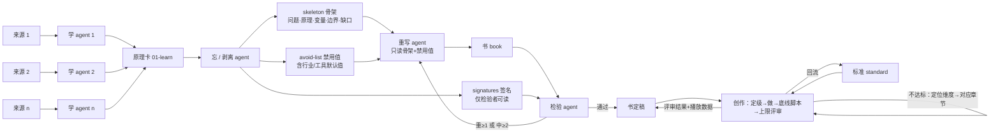

# 青出 · Indigo

> **English summary.** *Indigo* (from the Chinese proverb "indigo comes from the indigo plant, yet is bluer than it" — the student surpasses the teacher) is a domain-agnostic framework for turning other people's skills, tutorials and design know-how into a craft book of your own, without inheriting their style. Instead of installing a skill as-is, it runs four isolated steps: **Learn** (one agent per source extracts principle cards), **Forget** (a distiller strips names, numbers and concrete recipes into a skeleton of questions and principles, plus a hidden list of stripped signatures and a list of banned values, including industry/tool defaults), **Rewrite** (an agent that may only read the skeleton and the banned list re-derives every chapter from first principles, offering several directions per question), and **Check** (an independent agent compares the book against the hidden signatures and sends chapters back until reproduction falls below a threshold). A separate **Standard** defines measurable floors (L0–L2, script-checkable) and reference-based ceilings (L3–L4, pairwise comparison), so every work made with the book can be reviewed by someone other than its maker and fed back into the book.

---

## 一、为什么不直接装 skill

直接安装别人的 skill 或照抄教程，短期很快，长期有三个问题：

1. **风格锁定**：skill 里的具体数值、曲线、版式、口头禅会原样进入你的作品。你做出来的东西"像他"，而不是"像这个问题的好答案"。
2. **同质化**：所有装了同一个 skill 的人，产出趋同；平台上的观众很快会识别并疲劳。
3. **不可迁移**：你记住的是"他在那个场景下选了 0.6 秒"，而不是"为什么是这个量级、换场景该怎么算"。换个片长、平台、内容就失效。

青出的做法是：**只保留"问题"和"原理"，强制丢掉"形"（具体数值、解法、来源特征），再由一个没见过原料的作者从原理重新推导**，最后用独立检验证明新书确实没有复现原料。配合一份质量标准，让"用书做出来的东西"可以被客观评审、并把评审结果回流修书。

核心循环：**学 → 忘 → 重写 → 检验**，外加 **标准**。

---

## 二、流程图



ASCII 简图：

```
 来源×n ─学(各自独立)─▶ 原理卡 ─忘─▶ ┌ skeleton  ──┐
                                     ├ avoid-list ─┼─▶ 重写 ─▶ 书 ─┐
                                     └ signatures ─(仅检验)────────┴▶ 检验 ─┬ 不过 → 退回重写
                                                                          └ 通过 → 定稿
 定稿的书 + 标准 ─▶ 创作：定目标级别 → 做 → 底线脚本 → 上限评审 → 回炉/通过 → 复盘回流
```

---

## 三、目录结构

```
craft-lib/
├─ SKILL.md                 入口 skill（indigo）：吸收 / 创作 两种模式
├─ framework/
│  ├─ README.md             本文
│  ├─ protocol.md           每一步的可执行规范与模板
│  └─ publish.md            公开发布注意事项
├─ 01-learn/                原理卡，每个来源一份（含他人具体做法，不公开）
├─ 02-forget/
│  ├─ skeleton*.md          骨架（可公开）
│  ├─ signatures.md         被剥离的签名（仅检验者可读，不公开）
│  ├─ avoid-list.md         禁用值（不公开）
│  └─ check-report*.md      各轮检验报告
├─ 03-book/                 书（当前动效领域：动效节奏.md；archive/ 存旧版）
├─ 04-create/               作品与评审记录
├─ 05-tools/                能力地图：原理 → 可用工具 → 实施纪律
└─ standards/               质量标准（当前：动效.md）
```

约定的目标结构是 `domains/<领域>/book.md`、`domains/<领域>/standard.md`；当前动效领域仍在 `03-book/动效节奏.md` 与 `standards/动效.md`，后续迁移。

---

## 四、如何吸收一个新来源

只走增量，不推倒重来：

1. **学**：为新来源单开一个 agent，只读该来源，产出原理卡。问题写成跨来源通用的形式（"一部片的能量该呈什么形状"，而不是"X 的能量表怎么填"）。
2. **并入骨架**：剥离 agent 把新卡按问题归入已有条目；真正的新问题用新编号追加，旧编号不改。更新共识强度和知识缺口。
3. **补签名 / 禁用值**：新来源的具体做法写进 signatures；其中有辨识度的值写进 avoid-list。
4. **只重写受影响章节**：重写 agent 依然只读骨架和禁用值，仅改动骨架有变化的章节。
5. **检验**：检验 agent 至少对受影响章节做全量签名比对；通过才合并。

详见 `protocol.md`。

---

## 五、如何用它做作品

1. **定目标级别**：这件作品要到 L2 商业合格、L3 精品还是冲 L4。"爆款"是独立的数据轴，不在质量分级里，不作为目标级别。
2. **用书创造**：按书里每章的取向做选择，并写下为什么选这个取向。
3. **底线检查**：跑标准里的可量化底线（脚本可检），不过不进评审。
4. **上限评审**：由**不是做片者**的独立评审 agent，拿标杆参照做两两比较，给出级别。
5. **回炉或通过**：不达标时，定位到失分维度 → 对应到书中章节 → 按该章回炉。
6. **复盘回流**：评审结论和上线后的播放数据，回流修订书与标准。

---

## 常见问题：这和大模型的「蒸馏」有什么区别？

表面相似：都是把别人的知识压缩、转移到自己这里。但目标正好相反。

| | 模型蒸馏 | 青出 |
|---|---|---|
| 目标 | 学生尽量**复现**老师的输出 | 复现被当作**失败**，检验发现就退回重写 |
| 转移的是什么 | 老师的答案和行为（形） | 只有问题、原理、边界（意），答案被剥掉 |
| 来源 | 通常一个老师 | 多个来源合并，找共识、分歧和所有来源都没回答的缺口 |
| 上限 | 学生一般不超过老师 | 从第一性原理重新推导，加上外部质量标准和真实数据回流，目标是超过来源 |
| 参照 | 只有老师 | 独立的质量标准 + 观众数据 |

打个比方：蒸馏像临摹，青出像读完书、合上书、自己写一本，再拿原书查重，然后拿去实践检验。

伦理上：我们学的是思想和原理（这本来就是学习的正常方式），刻意不复制具体表达；来源的具体做法不公开，来源清单与致谢公开。见 publish.md。

## 六、局限（请诚实看待）

- **"忘"不是真正的遗忘**，而是用信息隔离强制的：重写者读不到原料，但这完全依赖读权限被严格执行。一旦同一个上下文里混入原料，隔离就失效。
- **模型先验仍会造成趋同**。我们的实际发现是：即使重写者从没见过原料，它自己的"默认习惯"（常见缓动、常见时长、常见结构）也会和原料撞上。因此行业默认值、工具出厂值必须进 avoid-list。即便如此，方向上的趋同是常态，框架只保证"不复现形"，不保证"意也不同"。
- **LLM 检验并非完美**：复现/趋同的判定依赖检验 agent 的判断，可能漏判（尤其是结构同构）或误判（常见值巧合）。建议定期人工抽查。
- **L3/L4 无法保证**：书和标准能稳定地把作品抬到 L2 并识别 L0/L1；精品和惊艳依赖标杆选择、评审眼光和具体创作，框架只提供定位与回炉的路径。
- **数据轴有噪声**：播放数据受发布时间、推荐分发等影响，回流时只作为参考信号，不直接改写原理。
